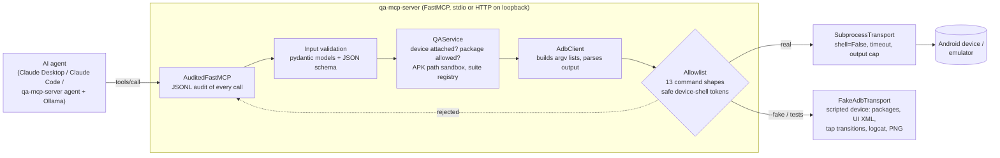

# qa-mcp-server

An MCP server that gives AI agents (Claude Desktop, Claude Code, any MCP client) ten Android QA tools over adb, with strict input validation, a command allowlist and an audit log, so an agent can explore an app without getting a shell.

[](https://github.com/Gabnagawo/qa-mcp-server/actions/workflows/ci.yml)

[](LICENSE)

## Why

LLM agents can now do useful exploratory testing: read a screen, try a flow,
notice a crash in logcat and write it up. The quick way to wire that up is to
give the agent `adb shell`. That also gives a shell to anyone who can put text
in front of the agent, through the app under test, a log line or a web page.

This server takes the other route. It exposes narrow, typed tools
(`dump_ui`, `tap`, `logcat`, ...) and enforces, below the agent, what may run:

- every argument is validated (pydantic and the published JSON schema);
- every adb argv must match one of 13 allowlisted command shapes, checked right before execution;
- processes start with `shell=False` and an argument list, under a timeout and an output cap;
- values that reach the device shell are restricted to a metacharacter-free charset, because `adb shell` re-joins arguments into a device-side shell command;
- APKs install only from a sandboxed directory; test suites run only by name, as configured by the operator;
- a dry-run mode plans state-changing commands without executing them;
- every call (accepted, rejected or failed) goes to a JSONL audit log with the exact argv.

The threat model is in [docs/SECURITY.md](docs/SECURITY.md).

## How it works



The fake device sits *below* the allowlist and speaks the same argv protocol as
adb (`devices -l`, `am start -W`, `uiautomator dump /dev/tty`, threadtime
logcat, `screencap -p`). Tests and demos therefore exercise the real
validation, policy, argv building and output parsing; only the process call is
replaced.

| Tool | What it does | Mutates device |
|---|---|---|
| `list_devices` | `adb devices -l`, parsed | no |
| `install_apk` | install an `.apk` from the allowed directory (path, suffix, ZIP signature and size checked) | yes |
| `launch_app` | start a package (launcher resolved automatically), returns `COLD`/`HOT` and `TotalTime` | yes |
| `screenshot` | PNG as MCP image content, or saved under the artifacts dir | no |
| `logcat` | dump filtered by package (pid), tag, minimum level and time, line- and byte-capped | no |
| `dump_ui` | uiautomator hierarchy as compact JSON: class, text, resource_id, content_desc, bounds, flags | no |
| `tap` | by `x,y`, or by `text` / `resource_id` / `content_desc` resolved through a fresh UI dump | yes |
| `input_text` | type into the focused field; fails if nothing has focus | yes |
| `press_key` | one key from an allowlist (BACK, HOME, ENTER, DEL, DPAD_*, ...) | yes |
| `run_test_suite` | run an operator-configured suite by name; returns exit code, output tail and JUnit totals | runs host process |

## Quick start

```bash
git clone https://github.com/Gabnagawo/qa-mcp-server && cd qa-mcp-server
uv sync
uv run python examples/demo_transcript.py      # same as: make demo
```

The demo starts the server as a stdio subprocess with the fake device, runs an
exploratory session on a synthetic notes app with a planted crash, then sends a
few injection attempts. No device, no API key.

Other entry points (Windows has no `make`, so each target is shown as a `uv run` command):

| Task | make | uv |
|---|---|---|
| tests + coverage | `make test` | `uv run pytest` |
| security matrix only | `make security` | `uv run pytest tests/test_security_matrix.py -q --no-cov` |
| latency benchmark | `make bench` | `uv run python examples/benchmark_latency.py --iterations 200` |
| LLM agent on the fake device (Ollama) | `make agent` | `uv run qa-mcp-server agent --fake --apk-dir examples/apks` |
| print the adb allowlist | `make allowlist` | `uv run qa-mcp-server allowlist` |
| run the server (real adb) | | `uv run qa-mcp-server serve --config qa-mcp.toml` |

### Use it from Claude

Copy [examples/qa-mcp.example.toml](examples/qa-mcp.example.toml) to
`qa-mcp.toml` and set `apk_dir`, `artifacts_dir` and, ideally,
`allowed_packages`. Add `--fake` to any command below to try it without a device,
or `--dry-run` to see what an agent would do before letting it act.

**Claude Desktop**: edit `claude_desktop_config.json`, then restart Claude Desktop.

- macOS: `~/Library/Application Support/Claude/claude_desktop_config.json`
- Windows: `%APPDATA%\Claude\claude_desktop_config.json`

```json
{
  "mcpServers": {
    "qa-android": {
      "command": "uv",
      "args": [
        "--directory", "/Users/you/src/qa-mcp-server",
        "run", "qa-mcp-server", "serve",
        "--config", "/Users/you/src/qa-mcp-server/qa-mcp.toml"
      ]
    }
  }
}
```

On Windows, use Windows paths with escaped backslashes, for example
`"--directory", "C:\\src\\qa-mcp-server"`. If `uv` or `adb` is not on the PATH
that Claude Desktop sees, give the absolute path to `uv.exe` in `command` and set
`adb_path` in the TOML file.

**Claude Code**:

```bash
claude mcp add qa-android -- uv --directory /path/to/qa-mcp-server run qa-mcp-server serve --config /path/to/qa-mcp.toml
# or over streamable HTTP (loopback only unless --allow-remote):
uv run qa-mcp-server serve --transport http --port 8765 --config qa-mcp.toml
claude mcp add --transport http qa-android http://127.0.0.1:8765/mcp
```

[docs/DEMO.md](docs/DEMO.md) is a scripted exploratory session on a real F-Droid
app (Markor) with the expected sequence of tool calls.

## Example output

Real output of `uv run python examples/demo_transcript.py` (also saved in
[docs/results/demo-transcript.txt](docs/results/demo-transcript.txt)). The
server runs as a stdio subprocess against the fake device; the times are
client-side round trips. The synthetic app crashes on "Export as PDF", the
crash is found through `dump_ui` and `logcat`, and the injection attempts at the
end are rejected before anything runs.

```text
$ uv run python examples/demo_transcript.py
server qa-mcp-server 0.1.0 (stdio, fake device)
10 tools: list_devices, install_apk, launch_app, screenshot, logcat, dump_ui, tap, input_text, press_key, run_test_suite

== exploratory session ==
#1  list_devices()  [11.5 ms]
    -> online=1  [emulator-5554 (device), FAKE-DEVICE-0001 (offline)]
#2  install_apk(apk_path='sample-notes-1.0.apk')  [8.7 ms]
    -> installed=True sample-notes-1.0.apk sha256=a9f36ce9e261...
#3  launch_app(package='org.qamcp.sample.notes')  [10.3 ms]
    -> org.qamcp.sample.notes/.MainActivity status=ok COLD 412 ms
  # read the screen before acting
#4  dump_ui()  [4.6 ms]
    -> 7 nodes; TextView:'Notes', ImageView:'More options', TextView:'No notes yet', FloatingActionButton:'New note'
#5  tap(content_desc='New note')  [10.4 ms]
    -> tapped (960, 2200) on org.qamcp.sample.notes:id/fab_new_note
#6  tap(resource_id='title_input')  [10.6 ms]
    -> tapped (540, 405) on org.qamcp.sample.notes:id/title_input
#7  input_text(text='Groceries')  [7.1 ms]
    -> {"action": "input_text", "detail": "typed 9 characters into org.qamcp.sample.notes:id/title_input", "dry_run": false}
#8  tap(text='Save')  [10.9 ms]
    -> tapped (886, 2250) on org.qamcp.sample.notes:id/save_button
  # verify the note is listed
#9  dump_ui()  [4.9 ms]
    -> 10 nodes; TextView:'Notes', ImageView:'More options', TextView:'Groceries', TextView:'Note saved', FloatingActionButton:'New note'
#10 logcat(package='org.qamcp.sample.notes', level='W')  [13.3 ms]
    -> 1 lines
        W/StrictMode: StrictMode policy violation; ~duration=18 ms: android.os.strictmode.DiskReadViolation
#11 tap(content_desc='New note')  [11.1 ms]
    -> tapped (960, 2200) on org.qamcp.sample.notes:id/fab_new_note
  # risky action
#12 tap(content_desc='Export as PDF')  [11.0 ms]
    -> tapped (114, 2250) on org.qamcp.sample.notes:id/export_button
  # what happened?
#13 dump_ui()  [5.0 ms]
    -> 3 nodes; TextView:'Sample Notes keeps stopping', Button:'App info', Button:'Close app'
#14 logcat(tag='AndroidRuntime', level='E')  [14.7 ms]
    -> 6 lines
        E/AndroidRuntime: FATAL EXCEPTION: main
        E/AndroidRuntime: Process: org.qamcp.sample.notes, PID: 4242
        E/AndroidRuntime: java.lang.NullPointerException: Attempt to invoke virtual method 'java.io.File android.con
        E/AndroidRuntime: 	at org.qamcp.sample.notes.export.PdfExporter.export(PdfExporter.kt:42)
  # evidence for the bug report
#15 screenshot(save=True)  [4.0 ms]
    -> saved qa-mcp-artifacts/demo/screenshots/emulator-5554-20261112T131228116024Z.png (1006 bytes)
#16 tap(text='Close app')  [10.6 ms]
    -> tapped (540, 1340) on android:id/aerr_close
#17 run_test_suite(name='smoke')  [451.0 ms]
    -> exit=0 passed=True junit={'tests': 3, 'failures': 0, 'errors': 0, 'skipped': 0} in 0.438s

== a prompt-injected agent tries to escape ==
#18 input_text(text='hi; reboot')  [2.2 ms]
    -> REJECTED: 1 validation error for InputTextRequest text String should match pattern '^[A-Za-z0-9 @._,:/+=-]{1,500}$' [type=string_pattern_mismatch, input_value='hi; reboot', input_t
#19 launch_app(package='org.qamcp.sample.notes', activity='.Main$(id)')  [1.9 ms]
    -> REJECTED: 1 validation error for launch_appArguments activity String should match pattern '^\.?[A-Za-z_][A-Za-z0-9_]*(?:\.[A-Za-z_][A-Za-z0-9_]*)*$' [type=string_pattern_mismatch, 
#20 install_apk(apk_path='../../pyproject.toml')  [2.6 ms]
    -> REJECTED: apk_path escapes the allowed APK directory
#21 press_key(key='POWER')  [2.0 ms]
    -> REJECTED: 1 validation error for PressKeyRequest Value error, key not allowed: 'POWER'; allowed: ['APP_SWITCH', 'BACK', 'DEL', 'DPAD_CENTER', 'DPAD_DOWN', 'DPAD_LEFT', 'DPAD_RIGHT'
#22 run_test_suite(name='smoke; rm -rf /')  [1.8 ms]
    -> REJECTED: 1 validation error for RunSuiteRequest name String should match pattern '^[a-z0-9][a-z0-9_-]{0,63}$' [type=string_pattern_mismatch, input_value='smoke; rm -rf /', input_t
#23 logcat(serial='emulator-5554 && reboot')  [2.0 ms]
    -> REJECTED: 1 validation error for logcatArguments serial String should match pattern '^[A-Za-z0-9][A-Za-z0-9._:-]{0,63}$' [type=string_pattern_mismatch, input_value='emulator-5554 &

audit log: 23 tool calls {'ok': 17, 'rejected': 6}, 42 adb/suite commands executed -> qa-mcp-artifacts/demo/audit.jsonl
```

Two lines from the audit log of that run (`qa-mcp-artifacts/demo/audit.jsonl`): an
accepted call with the four adb commands it executed, and a rejected one that executed nothing.

```json
{"ts": "2026-11-12T13:12:28.002+00:00", "tool": "launch_app", "arguments": {"package": "org.qamcp.sample.notes"}, "outcome": "ok", "duration_ms": 1.2, "dry_run": false, "commands": [{"rule": "devices", "argv": ["adb", "devices", "-l"], "executed": true}, {"rule": "pm_path", "argv": ["adb", "-s", "emulator-5554", "shell", "pm", "path", "org.qamcp.sample.notes"], "executed": true}, {"rule": "resolve_launcher", "argv": ["adb", "-s", "emulator-5554", "shell", "cmd", "package", "resolve-activity", "--brief", "-c", "android.intent.category.LAUNCHER", "org.qamcp.sample.notes"], "executed": true}, {"rule": "am_start", "argv": ["adb", "-s", "emulator-5554", "shell", "am", "start", "-W", "-n", "org.qamcp.sample.notes/.MainActivity"], "executed": true}]}
{"ts": "2026-11-12T13:12:28.584+00:00", "tool": "install_apk", "arguments": {"apk_path": "../../pyproject.toml"}, "outcome": "rejected", "duration_ms": 0.811, "dry_run": false, "commands": [], "error": "Error executing tool install_apk: apk_path escapes the allowed APK directory"}
```

## Results

All numbers below come from runs made in this repository on 2026-11-12. The raw
outputs are in [docs/results/](docs/results/). Machine: Windows 11, AMD64
(Family 23 Model 96), Python 3.12.10. No Android device was attached.

| Metric | Result | Reproduce |
|---|---|---|
| MCP tools exposed | **10** | `uv run python examples/demo_transcript.py` (header line) |
| Tests | **244 passed, 1 skipped** (the symlink-escape case needs symlink privilege on Windows) | `uv run pytest` -> [pytest.txt](docs/results/pytest.txt) |
| Line + branch coverage | **98.44 %** (CI gate: 80 %) | `uv run pytest` |
| Lint / types | ruff check and format clean, mypy `--strict` clean (19 files) | see [lint.txt](docs/results/lint.txt) |
| Security matrix: rejected injection cases | **118 rejected, 0 accepted** (1 more skipped on Windows): 69 tool-call cases through a real MCP client (39 command injection, 13 path traversal, 8 policy, 8 limits, 1 package allowlist) + 49 raw adb argv against the allowlist | `uv run pytest tests/test_security_matrix.py -v --no-cov` -> [security-matrix.txt](docs/results/security-matrix.txt) |
| All `security`-marked tests | 126 passed, 1 skipped (matrix + `shell=False`, timeout, process-tree kill, output cap, XML bomb, XXE) | `uv run pytest -m security --no-cov` -> end of [security-matrix.txt](docs/results/security-matrix.txt) |
| Tool-call latency, fake device, in-process | p50 **8.81 ms**, p95 **15.11 ms** over 2,400 calls (12 call types x 200) | `uv run python examples/benchmark_latency.py --iterations 200` -> [latency.txt](docs/results/latency.txt) |
| Tool-call latency, fake device, stdio subprocess | p50 **10.10 ms**, p95 **15.00 ms** over 2,400 calls | same command |
| Latency of a rejected call | p50 1.03 ms (in-process), 2.13 ms (stdio) | same command |
| Where the time goes | in a cProfile of 100 `list_devices` calls, 50 % of self-time is the MCP SDK's JSON Schema validation of structured output and 0.5 % is this package's code | `uv run python examples/profile_call.py` -> [profile-list_devices.txt](docs/results/profile-list_devices.txt) |
| Tool-call latency on a real device | to be measured | |
| Markor exploratory session ([DEMO.md](docs/DEMO.md)) | to be measured | |

**LLM agent runs (Ollama, `qwen3:8b`, local, fake device).** The reference loop
(`uv run qa-mcp-server agent --fake --apk-dir examples/apks`) was run 7 times.
Every run is saved in `docs/results/agent-ollama-qwen3-8b-run*.txt`.

| Run | Outcome | What changed after it |
|---|---|---|
| 1 | Finished after 10 tool calls (1 min 52 s). Typed the title without focusing the field, so the text was dropped, yet reported "the note was saved correctly". Never tried the export action, so it missed the planted crash. | `input_text` now fails when nothing has focus |
| 2 | Ollama HTTP 500 after 4 calls. `ollama ps` showed the model loaded with a 4096-token context, so context overflow is the suspected cause | send `num_ctx` 16384 and compact JSON tool results |
| 3 | 7 calls. Received the new "no focused input field: tap the field first" error, then Ollama aborted: `token repeat limit reached` | Qwen3-recommended sampling instead of greedy decoding |
| 4 | Model printed its tool call as text, so the loop took it as the final answer (2 calls) | parse Hermes-style `<tool_call>` text |
| 5 | `token repeat limit reached` after 3 calls | thinking mode made optional (`OLLAMA_THINK`) |
| 6 | Thinking on: `token repeat limit reached` before the first call | retries use a new seed |
| 7 | `token repeat limit reached` after 3 calls, on all three attempts | none (stopped here) |

So the agent loop and the server work end to end with a local model, but
`qwen3:8b` on this machine did not complete the exploratory goal reliably. The
first run shows why the audit log and fail-loud tools matter: the model's report
claimed a result the device never showed. Runs with a hosted model
(`LLM_PROVIDER=anthropic`) are to be measured.

## Limitations

- **No real device was attached where this was built.** Every number above comes
  from the scripted fake device. Real-device latency is dominated by adb and
  `uiautomator dump` and is to be measured, as is the Markor session in
  [docs/DEMO.md](docs/DEMO.md).
- The fake device reproduces adb's output formats (`devices -l`, `am start -W`,
  `uiautomator dump /dev/tty`, threadtime logcat). It is not an emulator, and
  per-device differences are untested: `uiautomator dump /dev/tty`,
  `cmd package resolve-activity` and `logcat --pid` need a reasonably recent
  Android (7+), and OEM builds vary.
- `input_text` accepts a shell-safe ASCII subset only (letters, digits, space,
  `@._,:/+=-`). Quotes, `#`, `?`, `*`, `%`, non-ASCII and emoji are rejected
  rather than escaped. Full Unicode input needs an IME-based approach (roadmap).
- Selectors match `text`, `resource_id` or `content_desc` on the current screen
  only. There is no scrolling to off-screen elements and no XPath, and WebViews or
  Compose screens without semantics expose few nodes.
- Allowed actions are still powerful: a tap can land in any app, including
  Settings. Use a disposable emulator or test device (see
  [SECURITY.md](docs/SECURITY.md#residual-risk-what-this-does-not-solve)).
- The HTTP transport has no authentication. It binds to loopback and refuses
  other interfaces without `--allow-remote`.
- One device per call, and there is no locking between concurrent clients on the same device.
- The bundled agent loop is a reference client. With a small local model
  (qwen3:8b) it follows the tool protocol but skips steps and can over-report
  success (see Results). Treat agent reports as leads and check them against the audit log.
- On Windows without symlink privilege, the symlink-escape test is skipped. It runs on Linux CI.

## Roadmap

- Record the Markor session from [docs/DEMO.md](docs/DEMO.md) on an emulator and replace the "to be measured" rows with real numbers.
- `swipe` / `scroll_to` tools, with the same allowlist treatment.
- Optional per-tool rate limits and a confirmation hook (MCP elicitation) for `install_apk` and `run_test_suite`.
- Structured crash extraction (`FATAL EXCEPTION` and ANR blocks grouped per process) as a dedicated tool.
- Authentication for the HTTP transport.
- Publish to PyPI so `uvx qa-mcp-server` works without a clone.

## License

MIT, see [LICENSE](LICENSE). Copyright (c) 2026 Gabriel Nagawo.
